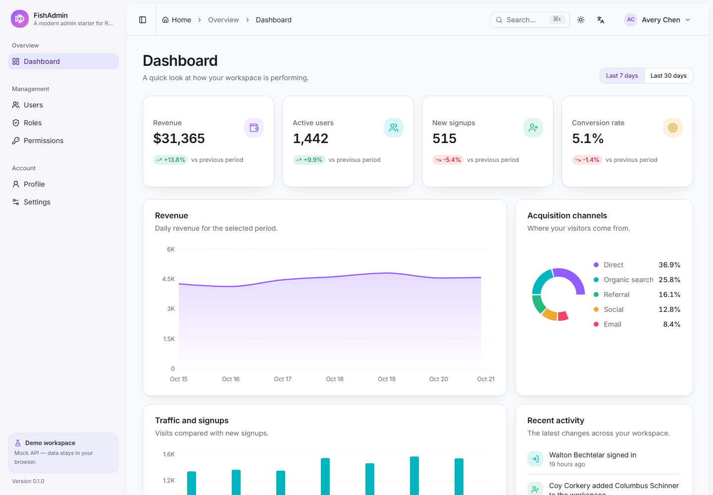
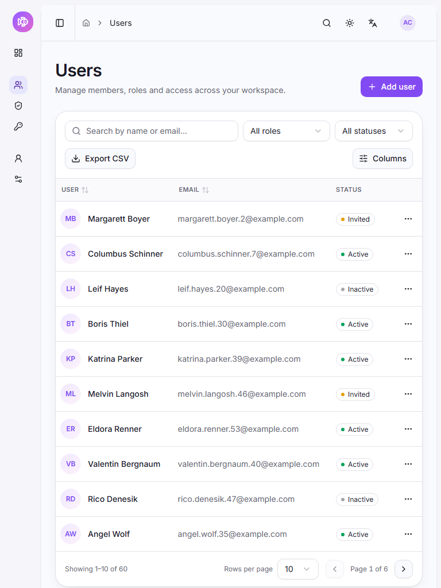
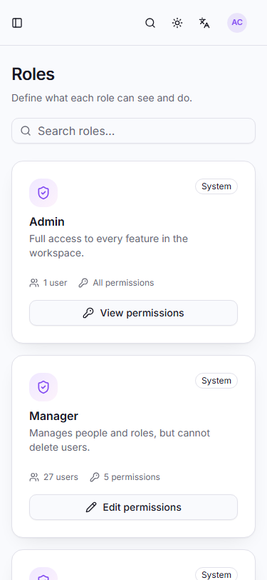
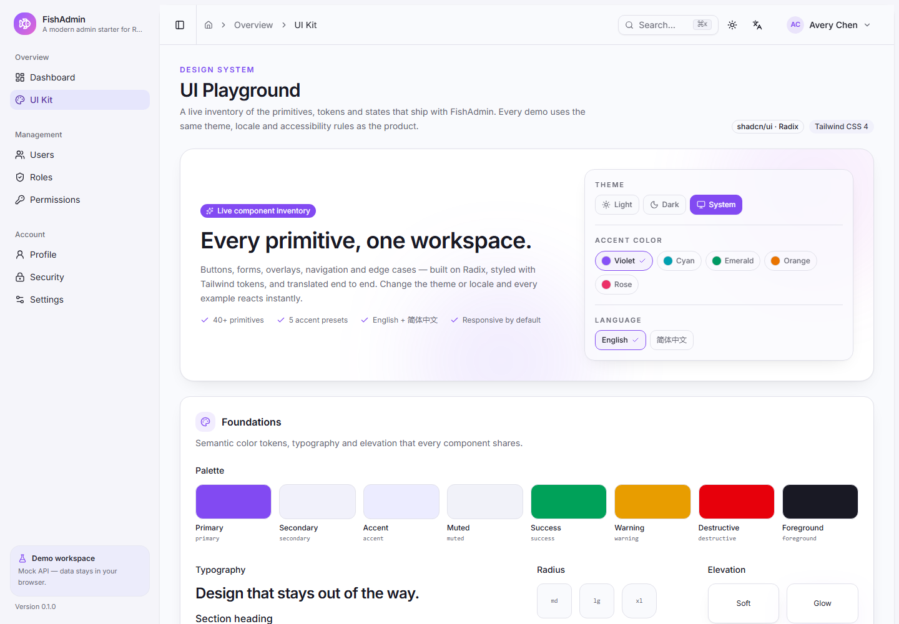

# FishAdmin

**A production-minded React admin dashboard starter with RBAC, i18n, theming, charts and a realistic mock API.**

English · [简体中文](./README.zh-CN.md)

[](https://github.com/flyingfishzxf/fish-admin/actions/workflows/ci.yml)
[](https://react.dev)
[](https://vite.dev)
[](https://www.typescriptlang.org)
[](https://tailwindcss.com)
[](./LICENSE)

FishAdmin is not another page gallery. It is a front-end starter you can clone, log into, break on purpose and then connect to your own backend. Authentication, route/menu/button permissions, data tables, charts, themes and two languages are already wired together.

> **Security note:** client-side RBAC is a UX layer, **not a security boundary**. Every permission check in this project can be bypassed by editing JavaScript or calling the API directly. Your backend must enforce authorization. The mock API returns `403` for forbidden writes to demonstrate the expected contract.

## Preview



| Users on tablet                                                  | Roles on mobile                                                 | UI playground                                                               |
| ---------------------------------------------------------------- | --------------------------------------------------------------- | --------------------------------------------------------------------------- |
|  |  |  |

## Features

- **Full account lifecycle** — login, registration with email verification, forgot/reset password, invitation links, TOTP-style two-factor sign-in, five-attempt lockout, password change and a per-device session list. Session restore uses single-flight refresh-token rotation, deep-link redirect after login and global 401 handling.
- **Three-level RBAC** — navigation, route guards and button-level `<Can>` checks derived from one permission registry. Admin, Manager and Viewer accounts are ready to compare.
- **Realistic mock API** — MSW, a seeded in-memory database persisted to `localStorage`, 60 users, pagination, filtering, sorting, fake JWTs, refresh tokens, `403` responses and a demo-data reset.
- **Advanced users table** — URL-driven search, filters, sorting and paging; row selection with bulk status changes and bulk delete/restore (undo from the toast); column visibility, pinning and resizing; two densities; per-row context menu; saved views; CSV export; drawer forms with React Hook Form + Zod; loading, empty and error states.
- **Failure handling you can see** — dedicated `401`, `403`, `500`, `503` and maintenance screens, an offline banner with recovery toast, a route error boundary and preview links from Settings and the UI playground.
- **Dashboard** — KPI cards, revenue area chart, traffic bars, acquisition donut and recent activity, with a 7/30-day switch. Charts are lazy-loaded with the dashboard route.
- **Role and permission management** — editable permission tree with parent/child selection, a read-only permission registry, and an explicit session refresh after permission changes.
- **41 shadcn/ui primitives and a `/ui` playground** — every component, state and overlay rendered in one page, so you can check theming and translations before using them in your own screens.
- **Product-style design system** — light, dark and system modes, five accent colors, oklch tokens, refined shadows and a FOUC-free first paint.
- **English + Simplified Chinese** — lazy-loaded i18next namespaces, `Intl` date/number formatting and locale-aware validation messages.
- **Command palette** — `Ctrl/⌘ K` navigation and actions, filtered by the current role.
- **Responsive layout** — mobile sidebar sheet, adaptive tables and drawers that work at 375, 768 and 1440 pixels.
- **Engineering included** — strict TypeScript, Vitest + Testing Library, Playwright, ESLint, Prettier, Husky, lint-staged, commitlint, GitHub Actions, Docker and Vercel configuration.

## Quick start

Requirements: **Node.js >= 22** (24 LTS recommended) and **pnpm 9.1.1** (`corepack enable` is enough).

```bash
git clone <repository-url>
cd fish-admin
pnpm install
pnpm dev
```

Open http://localhost:5173. The mock API starts automatically in development.

### Demo accounts

| Role          | Email              | Password      | What it can do                                                                         |
| ------------- | ------------------ | ------------- | -------------------------------------------------------------------------------------- |
| Administrator | `admin@fish.dev`   | `Admin123!`   | Everything, including deleting users, editing role permissions and resetting demo data |
| Manager       | `manager@fish.dev` | `Manager123!` | Read dashboards and users, create and edit users, read roles                           |
| Viewer        | `viewer@fish.dev`  | `Viewer123!`  | Read the dashboard and users only                                                      |

The login page fills these credentials with one click. Mock data lives in your browser under `fish-admin:db:v1`; use **Settings → Reset demo data** or clear site storage to start over. These credentials exist only in the browser mock — never ship them to a real backend.

More things to try:

- **Two-factor sign-in** — enable 2FA on `/security`, sign out and sign in again. The demo code is `246810`; a real app would generate it from a TOTP secret.
- **Invitations** — open `/accept-invite?token=fish-demo-invite` to join as `manager`, then reload it to see the used-token screen.
- **Recovery** — `/forgot-password` returns a demo reset link so you can finish the flow without email delivery.
- **Failure screens** — `/401`, `/500`, `/503` and `/maintenance` are directly reachable, and the offline banner appears when you throttle the network.

## What is inside

### Routes

| Path                 | Description                                             | Required permission |
| -------------------- | ------------------------------------------------------- | ------------------- |
| `/`                  | Dashboard with KPIs, charts and activity                | `dashboard:read`    |
| `/ui`                | UI playground: every primitive, state and overlay       | signed in           |
| `/users`             | Users table, CRUD and bulk operations                   | `user:read`         |
| `/roles`             | Role cards and permission editor                        | `role:read`         |
| `/permissions`       | Read-only permission registry                           | `permission:read`   |
| `/profile`           | Profile details and avatar upload demo                  | signed in           |
| `/security`          | Password, two-factor authentication and active sessions | signed in           |
| `/settings`          | Theme, accent, language, status previews, demo reset    | signed in           |
| `/403`               | Access denied inside the app shell                      | signed in           |
| `/login`             | Sign in (and start MFA when the account has it)         | public              |
| `/register`          | Create an account, then verify the email                | public              |
| `/verify-email`      | Consumes the verification token                         | public              |
| `/forgot-password`   | Requests a reset link                                   | public              |
| `/reset-password`    | Sets a new password and signs out other sessions        | public              |
| `/accept-invite`     | Turns an invitation token into a `manager` account      | public              |
| `/otp`               | Second step after a successful password                 | public              |
| `/401` `/500` `/503` | Expired session, server error, unavailable service      | public              |
| `/maintenance`       | Planned-downtime screen                                 | public              |

Unknown paths render a 404 inside the shell when you are signed in; unauthenticated visitors are redirected to `/login?redirect=…` and returned to the original URL after signing in. Every page above is guarded by `beforeLoad`, and a throwing route falls back to an error boundary with a retry action instead of a blank screen.

### Roles and permissions

Permissions use a `resource:action` format and are defined in [`src/config/permissions.ts`](src/config/permissions.ts). Buttons, menus and routes are all derived from that registry.

| Role          | Permissions                                                              |
| ------------- | ------------------------------------------------------------------------ |
| Administrator | `*`                                                                      |
| Manager       | `dashboard:read`, `user:read`, `user:create`, `user:update`, `role:read` |
| Viewer        | `dashboard:read`, `user:read`                                            |

The route guard lives in each leaf route's `beforeLoad`; menu entries are filtered in [`src/config/nav.ts`](src/config/nav.ts); buttons use `<Can permission="user:delete">`. See [docs/en/rbac.md](docs/en/rbac.md) for the four-step guide to adding a permission.

### Mock API

The demo runs entirely in the browser through a Service Worker.

| Method   | Endpoint                     | Notes                                                            |
| -------- | ---------------------------- | ---------------------------------------------------------------- |
| `POST`   | `/api/auth/login`            | Tokens, or an MFA challenge when the account has 2FA             |
| `POST`   | `/api/auth/mfa/verify`       | Exchanges the challenge and the six-digit code for tokens        |
| `POST`   | `/api/auth/register`         | Creates an unverified `viewer`; returns the demo verify token    |
| `POST`   | `/api/auth/verify-email`     | Marks the address verified                                       |
| `POST`   | `/api/auth/forgot-password`  | Always `200`; returns the demo reset token when the account hits |
| `POST`   | `/api/auth/reset-password`   | Sets the password and revokes the other sessions                 |
| `GET`    | `/api/auth/invites/:token`   | Invitation preview                                               |
| `POST`   | `/api/auth/accept-invite`    | Creates the invited user and signs them in                       |
| `POST`   | `/api/auth/refresh`          | Rotates the refresh token                                        |
| `POST`   | `/api/auth/logout`           | Revokes the refresh token                                        |
| `GET`    | `/api/auth/me`               | Returns the current user and resolved permissions                |
| `GET`    | `/api/auth/sessions`         | Active sessions for the current user                             |
| `DELETE` | `/api/auth/sessions/:id`     | Revoke one session (never the current one)                       |
| `DELETE` | `/api/auth/sessions`         | Sign out every other session                                     |
| `POST`   | `/api/auth/change-password`  | Requires the current password                                    |
| `POST`   | `/api/auth/2fa/setup`        | Returns the demo secret and code                                 |
| `POST`   | `/api/auth/2fa/enable`       | Confirms the code and turns 2FA on                               |
| `POST`   | `/api/auth/2fa/disable`      | Confirms the password and turns 2FA off                          |
| `GET`    | `/api/users`                 | `page`, `pageSize`, `q`, `roleId`, `status`, `sort`, `order`     |
| `POST`   | `/api/users`                 | Requires `user:create`                                           |
| `GET`    | `/api/users/:id`             | Requires `user:read`                                             |
| `PATCH`  | `/api/users/:id`             | Requires `user:update`                                           |
| `DELETE` | `/api/users/:id`             | Requires `user:delete`; soft delete, cannot delete yourself      |
| `POST`   | `/api/users/bulk-status`     | Requires `user:update`; skips rows the caller may not touch      |
| `POST`   | `/api/users/bulk-delete`     | Requires `user:delete`; returns the ids actually removed         |
| `POST`   | `/api/users/restore`         | Requires `user:delete`; undo target for the bulk toast           |
| `GET`    | `/api/roles`                 | Roles with user and permission counts                            |
| `GET`    | `/api/roles/options`         | Lightweight role options                                         |
| `PUT`    | `/api/roles/:id/permissions` | Requires `role:update`                                           |
| `GET`    | `/api/permissions`           | Permission registry                                              |
| `GET`    | `/api/dashboard?range=7\|30` | Dashboard payload                                                |
| `PATCH`  | `/api/profile`               | Current user's profile                                           |
| `POST`   | `/api/__mock/reset`          | Reseeds users, roles and tokens, keeps the current session       |

Access tokens are fake base64url JWTs valid for 15 minutes; refresh tokens last 7 days, verification tokens 24 hours and password-reset tokens 30 minutes. Five wrong passwords lock an email for one minute. The client retries a request once after refreshing; if that fails it clears the session and redirects to login. In a real deployment, prefer `httpOnly` cookies over `localStorage` and never return reset or verification tokens in a response body — see [docs/en/api-integration.md](docs/en/api-integration.md).

### Tech stack

| Layer                     | Choice                                                            |
| ------------------------- | ----------------------------------------------------------------- |
| Runtime / package manager | Node 24 LTS, pnpm 9.1.1                                           |
| Build                     | Vite 8, React 19, TypeScript (strict)                             |
| Styling                   | Tailwind CSS 4, shadcn/ui (new-york), Radix UI, Lucide icons      |
| Routing                   | TanStack Router 1 (file-based, typed search params, route guards) |
| Data                      | TanStack Query 5, Zustand 5                                       |
| Forms                     | React Hook Form, Zod 4                                            |
| Tables / charts           | TanStack Table 8, Recharts 3                                      |
| i18n                      | i18next, react-i18next                                            |
| Mock API                  | MSW 2, Faker (fixed seed)                                         |
| Testing                   | Vitest, React Testing Library, Playwright                         |
| Quality                   | ESLint 9, Prettier, Husky, lint-staged, commitlint                |

## Project structure

```text
src/
├─ routes/                 # File-based routes; routeTree.gen.ts is generated
├─ features/               # auth, dashboard, users, roles, permissions, profile, security, settings, playground
├─ components/
│  ├─ ui/                  # 41 shadcn/ui components
│  ├─ layout/              # AppShell, sidebar, header, breadcrumbs, command menu, offline banner
│  ├─ data-table/          # Table, pagination, column visibility
│  └─ common/              # Can, PageHeader, EmptyState, StatusScreen, theme/language toggles
├─ config/                 # env, permissions, navigation, theme presets, demo data
├─ lib/                    # API client, auth helpers, i18n, formatting, CSV, online status
├─ stores/                 # Auth, theme and UI Zustand stores
├─ locales/{en,zh-CN}/     # Lazy-loaded namespaces
├─ mocks/                  # MSW handlers, seeded database, fake auth
└─ styles/index.css
e2e/                       # Playwright specs
docs/{en,zh-CN}/           # Documentation
```

## Scripts

| Command                             | Description                                               |
| ----------------------------------- | --------------------------------------------------------- |
| `pnpm dev`                          | Start Vite with the mock API enabled                      |
| `pnpm build`                        | Type-check and build for production (mock off by default) |
| `pnpm build:demo`                   | Build with the mock API enabled, as used by the live demo |
| `pnpm preview`                      | Preview the production build                              |
| `pnpm lint` / `pnpm lint:fix`       | Run ESLint                                                |
| `pnpm format` / `pnpm format:check` | Run Prettier                                              |
| `pnpm typecheck`                    | Run TypeScript without emitting                           |
| `pnpm test` / `pnpm test:watch`     | Run unit tests                                            |
| `pnpm test:coverage`                | Unit tests with a coverage report                         |
| `pnpm test:e2e`                     | Build the demo and run Playwright                         |

## Connect your own backend

1. Set `VITE_ENABLE_MOCK=false` and `VITE_API_BASE_URL=https://your-api.example.com`.
2. Remove the mock bootstrap block in `src/main.tsx`, then delete `src/mocks` and `public/mockServiceWorker.js`.
3. Implement the endpoints in [docs/en/api-integration.md](docs/en/api-integration.md). You can keep the response shapes and adjust only the base URL while developing.
4. Enforce every permission on the server. The client checks improve UX; they do not protect your data.

If you keep the demo mock in a production build, set `VITE_ENABLE_MOCK=true` at build time and make sure `/mockServiceWorker.js` is served from the app root with a non-cached response.

## Deployment

- **Vercel** — import the repository. [`vercel.json`](vercel.json) builds `pnpm build:demo`, rewrites SPA routes and keeps the service worker revalidated. Use `pnpm build` instead if you connect a real API.
- **Docker** — `docker compose up --build` and open http://localhost:8080. The image builds with the demo API enabled; pass `--build-arg VITE_ENABLE_MOCK=false` to produce an API-only image.
- **Any static host** — serve `dist/`, rewrite unknown paths to `index.html`, and do not cache `mockServiceWorker.js`.

Details and subpath notes: [docs/en/deployment.md](docs/en/deployment.md).

## Documentation

- [Architecture](docs/en/architecture.md) — boot sequence, routing, data flow, theming and i18n.
- [RBAC](docs/en/rbac.md) — permission model, guards, adding a permission.
- [Account lifecycle](docs/en/account-lifecycle.md) — sign-up, verification, 2FA, sessions, failure screens and offline behaviour.
- [API integration](docs/en/api-integration.md) — contract, auth flow, replacing the mock.
- [Deployment](docs/en/deployment.md) — Vercel, Docker, nginx and service-worker pitfalls.
- [中文文档](docs/zh-CN/architecture.md)

## Contributing

Contributions are welcome. Read [CONTRIBUTING.md](CONTRIBUTING.md), run `pnpm lint && pnpm typecheck && pnpm test` before opening a pull request, and follow the Conventional Commits format. Please report security issues privately as described in [SECURITY.md](SECURITY.md).

## License

[MIT](./LICENSE) © FishAdmin contributors
