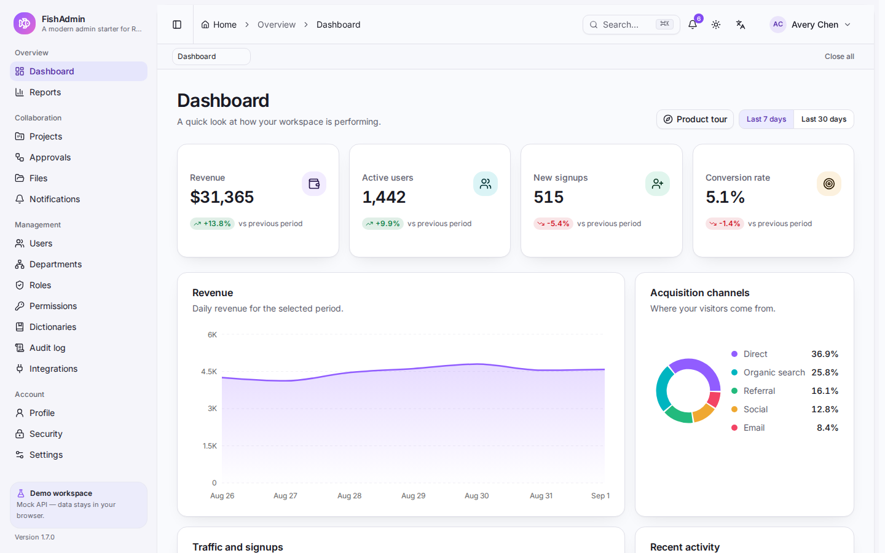
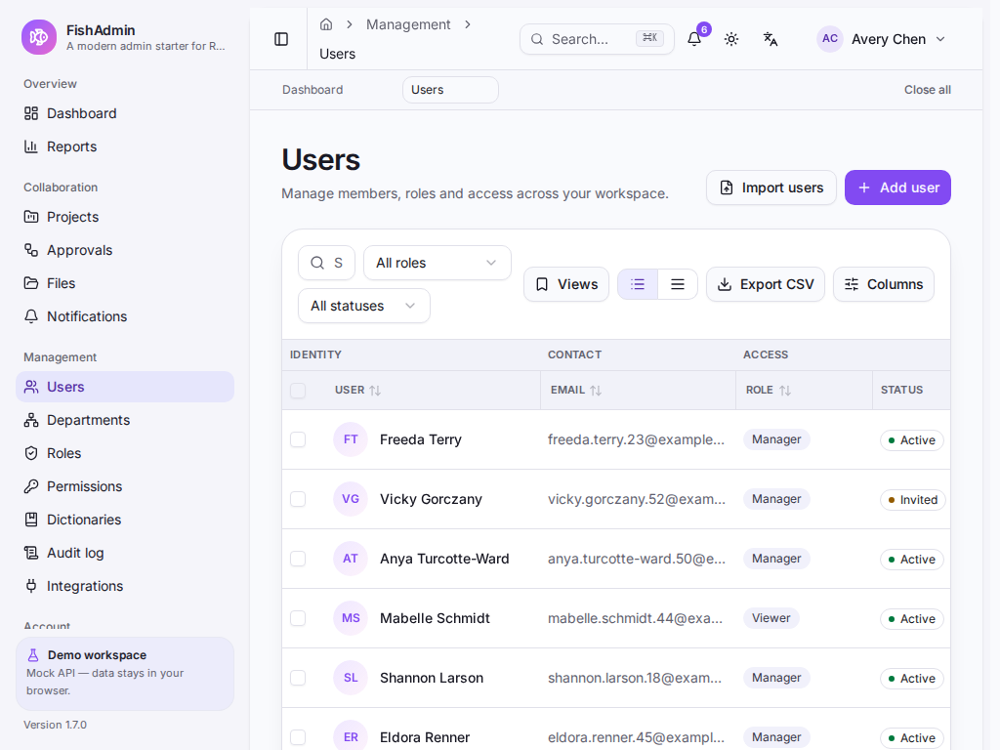
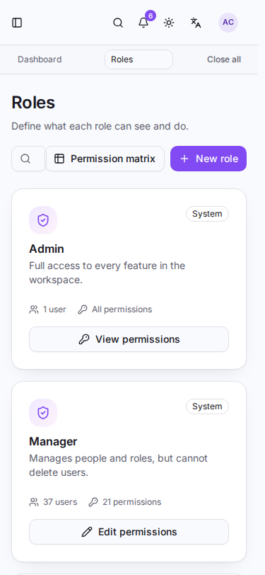
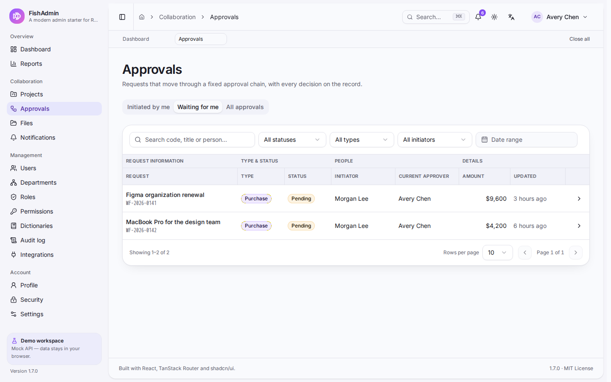

# FishAdmin

> **面向企业中后台的 React 组件库 —— 以及随它一起发布的模板工程。**

[English](./README.md) · 简体中文

[](https://github.com/flyingfishzxf/fish-admin/actions/workflows/ci.yml)
[](https://fish-admin-docs.vercel.app)
[](https://react.dev)
[](https://vite.dev)
[](https://www.typescriptlang.org)
[](https://tailwindcss.com)
[](./LICENSE)

FishAdmin 是两件事：`@fish-admin/react`（83 个有文档的组件，带深浅主题、中英文与按 RBAC 组织的页面），以及一套可以 clone 下来登录、故意越权试试、再换成自己后端的模板工程。[组件文档](https://fish-admin-docs.vercel.app) 是这两部分的统一入口。

> **安全声明：** 客户端 RBAC 只是交互层，**不是安全边界**。修改 JavaScript 或直接调用 API 都能绕过本项目的权限判断。真实权限必须由服务端校验。Mock API 对无权限的写操作返回 `403`，用于演示这一契约。

**在线演示：<https://fish-admin.vercel.app>** —— 使用 `pnpm build:demo` 构建，MSW Mock API 完全跑在你的浏览器里。可直接登录下面的[演示账号](#演示账号)；数据保存在 `localStorage`，清除站点数据即可恢复初始状态。线上的权限判断同样只是体验层，不是安全边界。

## 预览



| 1024px 下的用户列表                                                    | 375px 下的角色页                                                     | 审批中心                                                |
| ---------------------------------------------------------------------- | -------------------------------------------------------------------- | ------------------------------------------------------- |
|  |  |  |

这四张图同样由[文档站点](https://fish-admin-docs.vercel.app)在 `/screenshots/` 下提供。

## 功能

- **完整账号生命周期** —— 登录、注册与邮箱验证、忘记密码/重置、邀请链接、两步验证登录（TOTP 风格）、连续五次失败锁定、修改密码与多设备会话列表。会话恢复包含单飞刷新令牌轮换、登录后深链回跳与全局 401 处理。
- **三级 RBAC** —— 导航、路由守卫与按钮级 `<Can>` 全部由同一份权限注册表派生。25 个权限码覆盖项目、审批、文件、报表、集成、用户、角色、部门、字典与审计，管理员、经理、访客三种账号可一键切换对比。
- **三种壳层与页签工作台** —— 侧边栏、顶栏或混合导航，配紧凑密度与内容宽度上限，全部按浏览器持久化。访问过的页面成为页签，可固定、带 query 刷新、关闭右侧或全部关闭；被服务端菜单隐藏的路径不会留下页签。布局切换在设置页。
- **审批中心** —— `/workflows` 把申请分成我发起、待我审批与全部三视图，筛选条件跨页签保留；打开申请可查看快照、决定面板、时间线与评论，通过/驳回推进 Mock 状态机并写入审计事件。详见[审批中心](docs/zh-CN/workflows.md)。
- **真实感 Mock API** —— MSW + 固定种子的内存数据库（同步到 `localStorage`），60 个用户分布在 10 个部门节点，12 个项目含 72 条任务与 48 个里程碑，18 个文件分布在 8 个文件夹节点，6 个集成连接与 24 条投递记录，通知中心与偏好设置，220 条审计事件，支持分页、筛选、排序、假 JWT、刷新令牌、`403` 与演示数据重置。
- **项目交付工作台** —— `/projects` 组合 URL 驱动的筛选栏、看板/列表切换、精选项目轮播、创建向导、右键菜单、归档确认与分页；进入 `/projects/$id` 后可查看概览、任务、里程碑日历、成员转移、预算编辑、附件与复盘步骤条。
- **资源库** —— `/files` 将文件夹树与面包屑、网格/列表视图、上传队列、可拖拽预览分栏与水印、图片轮播、JSON 元数据、批量选择以及移动/删除串成一条流程。上传文件在客户端读成 data URL；大文件只保留元数据。
- **报表与通知** —— `/reports` 提供懒加载的 KPI/趋势/渠道报表，支持日期范围、粒度、目标阈值、锚点导航、回到顶部与 CSV 导出。`/notifications` 增加全部/未读/提及分段筛选、批量已读、详情抽屉、免打扰时段与渠道偏好；顶栏铃铛复用同一查询。
- **集成中心与用户导入** —— `/integrations` 管理 Webhook 连接、请求头、投递记录 payload 与重放；`/users` 新增批量导入向导，`/audit-logs` 可在详情抽屉查看原始事件 JSON，并跳转到项目、文件或集成实体。
- **产品导览** —— 工作台页头的导览按钮会依次指向侧边栏、搜索、通知铃铛与账户菜单。
- **高级用户表格** —— URL 驱动搜索、筛选、排序、分页；行选择与批量改状态、批量删除/恢复（Toast 可撤销）；列显隐、列拖动排序、列固定与列宽拖拽；两种行高密度；行右键菜单；保存视图；CSV 导出；Drawer 表单（RHF + Zod）；加载、空态与错误态齐全。
- **撑得住数据量的表格** —— `/users` 与 `/workflows` 采用窗口化渲染，表头分组吸顶、列可固定；`?dataset=large` 展示 5 000 行 Mock 数据时，DOM 中最多约 80 行。显隐、列序与列宽按用户持久化；合成数据只在内存生成，不写入 `localStorage`。详见[大表格](docs/zh-CN/tables.md)。
- **数据字典与参数配置** —— `/dictionaries` 维护两级字典类型与字典项，支持拖动或键盘排序、启停开关、引用计数与保护规则。用户详情把启用的 `user_tag` 项读作标签建议，改字典能直接看到效果。详见[数据字典](docs/zh-CN/dictionaries.md)。
- **用户详情与动态** —— `/users/$id` 汇总概览、标签即时编辑、头像拖拽上传与该用户的活动时间线，未知 ID 显示 Result 空状态。
- **组织架构树** —— `/departments` 提供可键盘导航的部门树、成员计数，以及新建子部门 / 重命名与可深链的选中态。
- **角色治理** —— 系统角色与自定义角色、两步创建向导，以及 `/roles/matrix` 权限矩阵：分组勾选、冻结表头与显式保存条。
- **审计日志** —— `/audit-logs` 支持 URL 同步筛选、日期区间预设、详情抽屉与关联事件，并可跳转到受影响的用户、角色或部门。
- **可见的异常处理** —— `401`、`403`、`500`、`503` 与维护页各有专页，断网时显示离线横幅并在恢复后提示，路由错误由 error boundary 兜底，设置页提供直达预览入口。
- **工作台** —— KPI 卡片、收入面积图、流量柱状图、渠道环形图、最近活动，支持 7/30 天切换；图表随路由懒加载。
- **83 个组件，一个包** —— `@fish-admin/react` 导出 47 个 shadcn/ui 原语、30 个企业组件与 6 个 Pro 组合（`DetailPage`、`EditableTable`、`ImportWizard`、`ProForm`、`QueryFilter`、`ProTable`）。83 个组件在[文档站点](https://fish-admin-docs.vercel.app)各有一页，中英双语，都带贴合业务场景的实时演示、可复制的 import 路径与自动生成的属性表。`pnpm check:package` 会在出口文件少导出任一条目时让构建失败，`pnpm docs:check` 会在页面、演示或登记项漂移时失败。ProTable 已用于用户与审计页，模板本身就是这个包的第一个使用者。
- **明快产品风设计系统** —— 亮色、暗色、跟随系统，5 套强调色，oklch 语义变量，轻量分层阴影，首屏无闪烁。
- **中英双语** —— i18next 按 namespace 懒加载，`Intl` 处理日期/数字，校验文案随语言切换。
- **命令面板** —— `Ctrl/⌘ K` 打开导航与快捷动作，按当前角色过滤。
- **响应式** —— 移动端侧边栏 Sheet、表格自适应、窄屏抽屉，375 / 768 / 1440 三档可用。
- **工程化齐全** —— 严格 TypeScript、Vitest + Testing Library、Playwright（含 axe 无障碍扫描）、gzip 打包体积与运行时性能预算、基于 Docker 的视觉回归、ESLint、Prettier、Husky、lint-staged、commitlint、GitHub Actions、Docker 与 Vercel 配置。

## 快速开始

环境要求：**Node.js >= 22**（推荐 24 LTS）、**pnpm 9.1.1**（`corepack enable` 即可）。

### 安装组件库

```bash
npm install @fish-admin/react
```

这就是模板在用的那 83 个组件。[安装](https://fish-admin-docs.vercel.app/guide/installation)说明 peer 依赖、Tailwind v4 的引入方式与 CSS 入口；[快速开始](https://fish-admin-docs.vercel.app/guide/quick-start)带你跑通第一张表格。

### 从演示开始

```bash
git clone <repository-url>
cd fish-admin
pnpm install
pnpm dev
```

打开 http://localhost:5173。开发环境会自动启动 Mock API。

### 从你自己的名字开始

```bash
git clone <repository-url> my-app && cd my-app
pnpm install
pnpm scaffold
```

它会重写品牌信息，并可以删掉多余语言，以及 mock API 和依赖它的 Playwright 套件。先跑 `pnpm scaffold --dry-run` 可以看到完整计划，详见 [docs/zh-CN/scaffold.md](docs/zh-CN/scaffold.md)。

### 演示账号

| 角色   | 邮箱               | 密码          | 能力                                                                 |
| ------ | ------------------ | ------------- | -------------------------------------------------------------------- |
| 管理员 | `admin@fish.dev`   | `Admin123!`   | 全部权限：删除用户与角色、编辑权限矩阵、重置数据                     |
| 经理   | `manager@fish.dev` | `Manager123!` | 管理项目、文件与用户；查看报表、集成、部门与审计；编辑自定义角色     |
| 访客   | `viewer@fish.dev`  | `Viewer123!`  | 只读工作台、项目、文件、报表、集成、用户、部门与审计；没有任何写权限 |

登录页支持一键填充。Mock 数据保存在浏览器的 `fish-admin:db:v1` 中，可在 **设置 → 重置演示数据** 或清除站点存储恢复初始状态。这些账号只存在于浏览器 Mock 中，请勿用于真实后端。

还可以试试：

- **项目** —— `/projects` 可按状态、优先级与负责人筛选。用两步向导创建项目，打开 `/projects/$id`，移动任务、编辑预算、转移成员、上传附件并完成复盘步骤条。
- **资源库** —— `/files` 浏览文件夹树、切换网格/列表、上传一张小图、打开预览分栏与水印、在文件夹间移动文件，并用可撤销的 Toast 删除文件。
- **通知** —— 顶栏铃铛显示未读数。`/notifications` 可切换全部/未读/提及、一键全部已读、打开详情抽屉，并保存免打扰时段与渠道偏好。
- **报表** —— `/reports` 调整日期范围、粒度、目标阈值与系列颜色，在锚点区间跳转、回到顶部并下载 CSV。
- **集成中心** —— `/integrations` 创建 Webhook、在行内表格编辑请求头、启停连接、查看投递 payload 并重放失败投递。
- **批量导入** —— `/users` → **导入用户** 依次完成粘贴 CSV、预览与提交，并在审计日志中留下记录。
- **产品导览** —— 点击工作台页头的 **产品导览** 按钮，依次高亮侧边栏、命令面板、通知铃铛与账户菜单。
- **两步验证** —— 在 `/security` 开启 2FA，登出后重新登录即进入验证码步骤。演示验证码是 `246810`；真实应用应由 TOTP 密钥生成。
- **邀请链接** —— 打开 `/accept-invite?token=fish-demo-invite` 以经理身份加入，再次访问可看到邀请已使用的提示。
- **找回密码** —— `/forgot-password` 会直接返回演示重置链接，无需真实邮件即可走完流程。
- **权限矩阵** —— 以管理员身份打开 `/roles/matrix`，勾选权限、保存并刷新；管理员列始终不可修改。
- **审计日志** —— `/audit-logs` 可按动作、对象与日期区间筛选，演示中的每次变更都会记录在案。
- **组织架构** —— `/departments?dept=dept-engineering` 可深链到节点，并分页查看其成员（含后代部门）。
- **异常页** —— `/401`、`/500`、`/503`、`/maintenance` 均可直接访问；在开发者工具中断网会出现离线横幅。
- **组件文档** —— 当 `VITE_DOCS_URL` 指向一个部署时，侧边栏、命令面板与宽屏登录页都会在新标签页打开[文档站点](https://fish-admin-docs.vercel.app)，已下线的 `/components` 与 `/ui` 也会重定向过去而不是 404。

## 项目内容

### 路由

| 路径                 | 说明                                     | 所需权限           |
| -------------------- | ---------------------------------------- | ------------------ |
| `/`                  | 工作台：KPI、图表、活动与产品导览        | `dashboard:read`   |
| `/reports`           | KPI、趋势与渠道报表，含锚点与 CSV 导出   | `report:read`      |
| `/projects`          | 项目组合：筛选、看板/列表、向导与分页    | `project:read`     |
| `/projects/$id`      | 项目工作台：任务、日历、预算与复盘       | `project:read`     |
| `/workflows`         | 审批中心：我发起、待我审批与全部         | `workflow:read`    |
| `/workflows/$id`     | 审批快照、决定、时间线与评论             | `workflow:read`    |
| `/files`             | 资源库：文件夹、上传、预览、移动与删除   | `file:read`        |
| `/notifications`     | 通知中心、批量已读与渠道偏好             | 已登录             |
| `/users`             | 用户表格、CRUD、批量操作与 CSV 导入      | `user:read`        |
| `/users/$id`         | 用户概览、标签、头像与动态时间线         | `user:read`        |
| `/departments`       | 部门树、成员与新建/重命名                | `department:read`  |
| `/dictionaries`      | 两级字典、排序、引用计数与保护规则       | `dictionary:read`  |
| `/roles`             | 角色卡片与权限编辑                       | `role:read`        |
| `/roles/matrix`      | 跨角色权限矩阵                           | `role:read`        |
| `/permissions`       | 只读权限注册表                           | `permission:read`  |
| `/audit-logs`        | 可筛选审计日志与原始 JSON 详情抽屉       | `audit:read`       |
| `/integrations`      | Webhook 连接、请求头与投递记录           | `integration:read` |
| `/profile`           | 个人资料与头像上传演示                   | 已登录             |
| `/security`          | 密码、两步验证与活动会话                 | 已登录             |
| `/settings`          | 主题、强调色、语言、异常页预览、重置数据 | 已登录             |
| `/403`               | 带应用外壳的无权限页                     | 已登录             |
| `/login`             | 登录（账号开启 2FA 时进入验证码步骤）    | 公开               |
| `/register`          | 注册并验证邮箱                           | 公开               |
| `/verify-email`      | 消费验证 token                           | 公开               |
| `/forgot-password`   | 申请重置链接                             | 公开               |
| `/reset-password`    | 设置新密码并登出其他会话                 | 公开               |
| `/accept-invite`     | 用邀请 token 创建经理账号                | 公开               |
| `/otp`               | 密码通过后的第二步验证                   | 公开               |
| `/401` `/500` `/503` | 会话过期、服务端错误、服务不可用         | 公开               |
| `/maintenance`       | 计划停机页                               | 公开               |

未知路径在登录状态下显示外壳内的 404；未登录访问受保护页面会跳转 `/login?redirect=…`，登录后回到原地址。两个已下线的组件目录路径是例外：设置了 `VITE_DOCS_URL` 时它们离开本应用、前往文档站点，没设置时和其他未知路径一样 404。所有页面守卫都写在 `beforeLoad` 中；路由渲染抛错时由 error boundary 展示可重试的兜底页，而不是白屏。

### 角色与权限

权限采用 `resource:action` 格式，注册表位于 [`src/config/permissions.ts`](src/config/permissions.ts)。菜单、按钮和路由都由这份注册表派生。

| 角色   | 权限                                                                                                                                                                                                                                                                             |
| ------ | -------------------------------------------------------------------------------------------------------------------------------------------------------------------------------------------------------------------------------------------------------------------------------- |
| 管理员 | `*`                                                                                                                                                                                                                                                                              |
| 经理   | `dashboard:read`、`project:read`、`project:manage`、`file:read`、`file:manage`、`report:read`、`integration:read`、`user:read`、`user:create`、`user:update`、`role:read`、`role:create`、`role:update`、`audit:read`、`department:read`、`department:manage`、`permission:read` |
| 访客   | `dashboard:read`、`project:read`、`file:read`、`report:read`、`integration:read`、`user:read`、`audit:read`、`department:read`                                                                                                                                                   |

路由守卫位于各叶子路由的 `beforeLoad`；侧边栏以 `GET /menu` 返回的列表为准，再按同一套权限码过滤，接口缺失时回落到 [`src/config/nav.ts`](src/config/nav.ts)；按钮使用 `<Can permission="user:delete">`。新增权限的四步说明见 [docs/zh-CN/rbac.md](docs/zh-CN/rbac.md)。

### Mock API

演示完全运行在浏览器中，由 Service Worker 拦截请求。

| 方法     | 端点                                                 | 说明                                                                                                                       |
| -------- | ---------------------------------------------------- | -------------------------------------------------------------------------------------------------------------------------- |
| `POST`   | `/api/auth/login`                                    | 返回令牌；账号开启 2FA 时返回验证挑战                                                                                      |
| `POST`   | `/api/auth/mfa/verify`                               | 用挑战 ID 与六位验证码换取令牌                                                                                             |
| `POST`   | `/api/auth/register`                                 | 创建未验证的访客账号，返回演示用验证 token                                                                                 |
| `POST`   | `/api/auth/verify-email`                             | 标记邮箱已验证                                                                                                             |
| `POST`   | `/api/auth/forgot-password`                          | 无论账号是否存在都返回 200；命中账号时给出演示重置 token                                                                   |
| `POST`   | `/api/auth/reset-password`                           | 设置新密码并吊销其他会话                                                                                                   |
| `GET`    | `/api/auth/invites/:token`                           | 邀请预览                                                                                                                   |
| `POST`   | `/api/auth/accept-invite`                            | 创建被邀请用户并直接登录                                                                                                   |
| `POST`   | `/api/auth/refresh`                                  | 轮换 refresh token                                                                                                         |
| `POST`   | `/api/auth/logout`                                   | 吊销 refresh token                                                                                                         |
| `GET`    | `/api/auth/me`                                       | 当前用户及有效权限                                                                                                         |
| `GET`    | `/api/auth/sessions`                                 | 当前用户的活动会话                                                                                                         |
| `DELETE` | `/api/auth/sessions/:id`                             | 吊销单个会话（不能吊销当前设备）                                                                                           |
| `DELETE` | `/api/auth/sessions`                                 | 退出其他全部会话                                                                                                           |
| `POST`   | `/api/auth/change-password`                          | 需要校验当前密码                                                                                                           |
| `POST`   | `/api/auth/2fa/setup`                                | 返回演示密钥与验证码                                                                                                       |
| `POST`   | `/api/auth/2fa/enable`                               | 校验验证码并开启 2FA                                                                                                       |
| `POST`   | `/api/auth/2fa/disable`                              | 校验密码并关闭 2FA                                                                                                         |
| `GET`    | `/api/users`                                         | `page`、`pageSize`、`q`、`roleId`、`status`、`departmentId`、`includeDescendants`、`sort`、`order`                         |
| `POST`   | `/api/users`                                         | 需要 `user:create`                                                                                                         |
| `GET`    | `/api/users/:id`                                     | 需要 `user:read`                                                                                                           |
| `PATCH`  | `/api/users/:id`                                     | 需要 `user:update`；支持 `departmentId`、`jobTitle`、`tags`、`avatar`                                                      |
| `DELETE` | `/api/users/:id`                                     | 需要 `user:delete`；软删除，不能删除自己                                                                                   |
| `POST`   | `/api/users/bulk-status`                             | 需要 `user:update`；跳过无权操作的对象                                                                                     |
| `POST`   | `/api/users/bulk-delete`                             | 需要 `user:delete`；返回真正被删除的 ID                                                                                    |
| `POST`   | `/api/users/restore`                                 | 需要 `user:delete`；供 Toast 撤销使用                                                                                      |
| `POST`   | `/api/users/import`                                  | 需要 `user:create`；校验行数据、返回逐行错误并创建通过的账号                                                               |
| `GET`    | `/api/roles`                                         | 角色及用户数、权限数                                                                                                       |
| `GET`    | `/api/roles/options`                                 | 轻量角色选项                                                                                                               |
| `POST`   | `/api/roles`                                         | 需要 `role:create`；重名返回 409 `ROLE_NAME_TAKEN`                                                                         |
| `PATCH`  | `/api/roles/:id`                                     | 需要 `role:update`；系统角色返回 `PROTECTED_ROLE`                                                                          |
| `DELETE` | `/api/roles/:id`                                     | 需要 `role:delete`；仍有成员时返回 `ROLE_IN_USE`                                                                           |
| `PUT`    | `/api/roles/:id/permissions`                         | 需要 `role:update`                                                                                                         |
| `GET`    | `/api/departments`                                   | 扁平部门列表，含直属与含后代人数                                                                                           |
| `POST`   | `/api/departments`                                   | 需要 `department:manage`；重名返回 409 `DEPARTMENT_NAME_TAKEN`                                                             |
| `PATCH`  | `/api/departments/:id`                               | 需要 `department:manage`；重命名或换父级，拒绝成环                                                                         |
| `GET`    | `/api/audit-events`                                  | 需要 `audit:read`；`page`、`pageSize`、`q`、`action`、`entityType`、`entityId`、`from`、`to`                               |
| `GET`    | `/api/audit-events/:id`                              | 需要 `audit:read`；返回事件及 5 条关联事件                                                                                 |
| `GET`    | `/api/permissions`                                   | 权限注册表                                                                                                                 |
| `GET`    | `/api/dashboard?range=7\|30`                         | 工作台数据                                                                                                                 |
| `GET`    | `/api/projects`                                      | 需要 `project:read`；`page`、`pageSize`、`q`、`status`、`priority`、`ownerId`、`departmentId`、`archived`、`sort`、`order` |
| `GET`    | `/api/projects/:id`                                  | 需要 `project:read`；项目及任务、里程碑、成员与附件                                                                        |
| `POST`   | `/api/projects`                                      | 需要 `project:manage`；重复 key 返回 409 `KEY_TAKEN`                                                                       |
| `PATCH`  | `/api/projects/:id`                                  | 需要 `project:manage`；状态、优先级、成员、预算、进度、标签、评分、复盘与归档                                              |
| `POST`   | `/api/projects/:id/tasks`                            | 需要 `project:manage`；在项目中创建任务                                                                                    |
| `PATCH`  | `/api/projects/:id/tasks/:taskId`                    | 需要 `project:manage`；标题、状态、负责人、截止日期与估时                                                                  |
| `PATCH`  | `/api/projects/:id/milestones/:milestoneId`          | 需要 `project:manage`；切换里程碑完成状态                                                                                  |
| `POST`   | `/api/projects/:id/attachments`                      | 需要 `project:manage`；把已有文件关联到项目                                                                                |
| `DELETE` | `/api/projects/:id/attachments/:fileId`              | 需要 `project:manage`                                                                                                      |
| `GET`    | `/api/file-folders`                                  | 需要 `file:read`；扁平文件夹树与文件计数                                                                                   |
| `GET`    | `/api/files`                                         | 需要 `file:read`；`folderId`、`q`、`kind`、`visibility`、`favorite`、`sort`、`order`、`updatedAfter`、`page`、`pageSize`   |
| `POST`   | `/api/files`                                         | 需要 `file:manage`；JSON 元数据，小文件可带 data URL                                                                       |
| `PATCH`  | `/api/files/:id`                                     | 需要 `file:manage`；名称、文件夹、可见性与收藏                                                                             |
| `DELETE` | `/api/files/:id`                                     | 需要 `file:manage`                                                                                                         |
| `POST`   | `/api/files/bulk-delete`                             | 需要 `file:manage`；返回真正被删除的 ID                                                                                    |
| `GET`    | `/api/reports`                                       | 需要 `report:read`；`from`、`to`（`yyyy-MM-dd`）与 `granularity=day\|week\|month`                                          |
| `GET`    | `/api/notifications`                                 | 已登录；`filter=all\|unread\|mentions`、`page`、`pageSize`                                                                 |
| `GET`    | `/api/notifications/:id`                             | 已登录；当前用户的一条通知                                                                                                 |
| `PATCH`  | `/api/notifications/:id`                             | 已登录；已读状态                                                                                                           |
| `POST`   | `/api/notifications/read`                            | 已登录；按 ID 批量标记已读                                                                                                 |
| `POST`   | `/api/notifications/read-all`                        | 已登录；全部标记已读                                                                                                       |
| `GET`    | `/api/notifications/preferences`                     | 已登录；免打扰时段、摘要频率与渠道                                                                                         |
| `PUT`    | `/api/notifications/preferences`                     | 已登录；保存免打扰时段、摘要频率与渠道                                                                                     |
| `GET`    | `/api/integrations`                                  | 需要 `integration:read`；`page`、`pageSize`、`q`、`provider`、`enabled`                                                    |
| `POST`   | `/api/integrations`                                  | 需要 `integration:manage`                                                                                                  |
| `PATCH`  | `/api/integrations/:id`                              | 需要 `integration:manage`；端点、事件、模式、启停与请求头                                                                  |
| `DELETE` | `/api/integrations/:id`                              | 需要 `integration:manage`                                                                                                  |
| `GET`    | `/api/integrations/deliveries`                       | 需要 `integration:read`；跨连接的最新 `limit` 条投递                                                                       |
| `GET`    | `/api/integrations/:id/deliveries`                   | 需要 `integration:read`；单个连接的投递记录                                                                                |
| `POST`   | `/api/integrations/:id/deliveries/:deliveryId/retry` | 需要 `integration:manage`；重放一条投递                                                                                    |
| `PATCH`  | `/api/profile`                                       | 当前用户资料                                                                                                               |
| `POST`   | `/api/__mock/reset`                                  | 重置用户、角色、部门、工作区数据与审计事件，保留当前会话                                                                   |

假 JWT 有效期 15 分钟，refresh token 有效期 7 天，验证 token 24 小时，重置 token 30 分钟；同一邮箱连续五次密码错误会锁定一分钟。客户端遇到 401 只做一次刷新并重试；失败则清空会话并跳转登录。真实部署建议改用 `httpOnly` Cookie，并且不要在响应体里返回验证或重置 token，详见 [docs/zh-CN/api-integration.md](docs/zh-CN/api-integration.md)。

### 技术栈

| 层              | 选型                                                            |
| --------------- | --------------------------------------------------------------- |
| 运行时 / 包管理 | Node 24 LTS、pnpm 9.1.1                                         |
| 构建            | Vite 8、React 19、TypeScript（strict）                          |
| 样式            | Tailwind CSS 4、shadcn/ui（new-york）、Radix UI、Lucide         |
| 路由            | TanStack Router 1（文件路由、类型安全 search params、路由守卫） |
| 数据            | TanStack Query 5、Zustand 5                                     |
| 表单            | React Hook Form、Zod 4                                          |
| 表格 / 图表     | TanStack Table 8、Recharts 3                                    |
| 国际化          | i18next、react-i18next                                          |
| Mock            | MSW 2、Faker（固定种子）                                        |
| 测试            | Vitest、React Testing Library、Playwright                       |
| 质量            | ESLint 9、Prettier、Husky、lint-staged、commitlint              |

## 目录结构

```text
packages/ui/                 # @fish-admin/react —— 组件库
├─ src/components/           # ui（47 个原语）、enterprise（30 个）、pro（6 个）、data-table、common
├─ src/locales/              # 组件自带的 en + zh-CN 文案
├─ src/styles/               # 设计令牌、工具类、preflight 与归应用的 base 样式
├─ registry.json             # 83 条登记项，gen-api 的输入
└─ test/                     # 包级测试
apps/docs/                   # Rspress 文档站点
├─ docs/{en,zh}/             # 83 个组件页、指南与版本页
├─ demos/<component>/        # 每个页面渲染的实时示例
├─ generated/                # registry.json 与 API 表，由 pnpm gen-api 生成
└─ public/screenshots/       # README 与文档首屏截图
src/                         # 模板
├─ routes/                   # 文件路由；routeTree.gen.ts 自动生成
├─ features/                 # auth、dashboard、users、roles、permissions、departments、audit、projects、files、reports、notifications、integrations、profile、security、settings
├─ components/
│  ├─ layout/                # AppShell、侧边栏、Header、通知铃铛、面包屑、命令面板、离线横幅
│  └─ common/                # Can、EmptyState、StatusScreen、主题/语言切换
├─ config/                   # env、权限、审计动作、导航、主题预设
├─ lib/                      # API 客户端、鉴权、i18n、格式化、CSV、在线状态
├─ stores/                   # 会话、主题、UI 状态
├─ locales/{en,zh-CN}/       # 懒加载语言包
├─ mocks/                    # MSW handlers、种子数据库、工作区种子与假鉴权
└─ styles/index.css
e2e/                         # Playwright 用例
docs/{en,zh-CN}/             # 仓库文档（上面那个站点才是产品文档）
```

## 常用命令

| 命令                                | 说明                                   |
| ----------------------------------- | -------------------------------------- |
| `pnpm scaffold`                     | 重写品牌信息，并删掉不需要的部分       |
| `pnpm dev`                          | 启动开发服务器（Mock 开启）            |
| `pnpm build`                        | 类型检查并构建生产包（默认关闭 Mock）  |
| `pnpm build:demo`                   | 开启 Mock 构建演示包                   |
| `pnpm preview`                      | 预览生产构建                           |
| `pnpm build:ui` / `pnpm test:ui`    | 构建 / 测试 `@fish-admin/react`        |
| `pnpm check:package`                | 导出必须覆盖注册表全部条目，否则失败   |
| `pnpm gen-api` / `gen-api:check`    | 重新生成 / 校验文档 API 表与覆盖率下限 |
| `pnpm docs:dev` / `docs:build`      | 运行 / 构建文档站点                    |
| `pnpm docs:check`                   | 缺页面、缺示例或注册表漂移即失败       |
| `pnpm test:docs`                    | 构建站点并运行它的 Playwright 用例     |
| `pnpm lint` / `pnpm lint:fix`       | 运行 ESLint                            |
| `pnpm format` / `pnpm format:check` | 运行 Prettier                          |
| `pnpm typecheck`                    | 仅跑 TypeScript 检查                   |
| `pnpm test` / `pnpm test:watch`     | 单元测试                               |
| `pnpm test:coverage`                | 带覆盖率的单元测试                     |
| `pnpm test:e2e`                     | 构建演示包并运行 E2E、axe 与性能用例   |
| `pnpm perf`                         | 仅运行运行时性能预算                   |
| `pnpm size`                         | 构建生产包并校验 gzip 体积预算         |
| `pnpm test:visual:docker`           | 在 Playwright Docker 镜像中比对截图    |

## 质量门禁

CI 在每次 push 和 pull request 上跑这些门禁：

- **无障碍** —— `eslint-plugin-jsx-a11y` 随 lint 一起运行，`e2e/a11y.spec.ts` 用 axe 按 WCAG 2.1 A/AA 扫描十二个流程（登录页的浅色、深色与中文，仪表盘浅色与深色，用户列表与新建弹窗，用户详情，角色与权限矩阵，审计日志，安全与设置，项目看板/新建弹窗/详情，文件库/上传抽屉/预览，通知中心与偏好，报表与集成表单）。出现任何违规即失败。文档站点另有 `e2e-docs/axe-full.spec.ts` 独立扫描。
- **打包体积** —— `pnpm size` 构建不含 Mock 的生产包，对每个 chunk 做 gzip 统计，四项预算超线即失败：首屏 JS 180 KB、最大懒加载分块 115 KB、JS 总量 800 KB、CSS 总量 30 KB。首屏口径是入口脚本加上 `dist/index.html` 中所有 `modulepreload` 标签，再算上首屏阻塞的 `/theme-bootstrap.js`——现在是 27 个 chunk、共 172.4 KB——因为浏览器在首屏前下载的是这一整组，而不是入口文件本身。CSS 总量同样计入通过 `<link>` 引入的 `/boot.css`。
- **运行时预算** —— `e2e/perf.spec.ts` 在仪表盘测量 FCP、LCP、CLS 与请求数。预算：FCP ≤ 2.5 s、LCP ≤ 3 s、CLS ≤ 0.1、请求数 ≤ 140。
- **视觉回归** —— 模板的十八张截图（登录页、仪表盘浅色与深色、用户、权限矩阵、审计日志、安全、设置、项目看板、项目详情、资源库、报表浅色与深色、通知中心、集成中心、审批中心、审批详情与数据字典）与文档站的八张基线（首页、安装、一个原语页、一个 pro 页，各取浅色与深色）都和 `mcr.microsoft.com/playwright:v1.64.1-noble` 中渲染的图片比对。Mock 数据库使用固定种子，测试冻结时钟，相对时间因此保持稳定。`e2e/visual/readme-shots.spec.ts` 在同一次运行里，但它只写文件，且只有设置 `README_SHOTS=1` 时才执行。
- **安全响应头** —— `e2e/security.spec.ts` 先比对 `/`、`/index.html`、一个带 hash 的资源与两个外壳文件的响应头是否完全一致，再带着 `securitypolicyviolation` 监听器走完登录、仪表盘、用户、报表、文件、项目与设置，监听器必须始终为空。详见 [docs/zh-CN/security-headers.md](docs/zh-CN/security-headers.md)。
- **文档站** —— `pnpm gen-api:check` 在生成的 props 表与包源码不一致时失败，`pnpm docs:check` 在某个注册表条目缺少页面、缺少示例或缺少译文时失败，`pnpm test:docs` 跑文档站自己的 Playwright 用例。
- **依赖供应链** —— `pnpm audit --audit-level=high` 有高危漏洞就让质量 job 失败，CodeQL 在每次 push、pull request 与每周定时任务中分析 JavaScript 和 TypeScript，[`.github/dependabot.yml`](.github/dependabot.yml) 为 npm 与 actions 分别开分组后的 minor/patch 和 major 升级 PR，所有 workflow 使用只读 token（`permissions: contents: read`），构建 job 还会上传被度量的产物。

基线按平台区分。请使用 `pnpm test:visual:docker`（需要 Docker），不要在本机直接运行 `pnpm test:visual`——本机脚本在非 Linux 环境会直接报错退出；有意的 UI 改动后用 `pnpm test:visual:docker --update` 重新生成基线。文档站同样有一对命令：`pnpm test:docs:visual` 与 `pnpm test:docs:visual:docker`。

## 接入真实后端

1. 设置 `VITE_API_BASE_URL=https://your-api.example.com`；若也要让开发服务器停止 Mock，再加 `VITE_ENABLE_MOCK=false`——构建产物本来就不含 Mock。`VITE_DOCS_URL` 可选：填上文档站的地址，侧边栏、命令面板与宽屏登录页就会出现组件文档入口。
2. 删除 `src/main.tsx` 中的 Mock 启动块，然后删除 `src/mocks` 与 `public/mockServiceWorker.js`。
3. 按 [docs/zh-CN/api-integration.md](docs/zh-CN/api-integration.md) 实现接口。开发阶段可先保持响应结构，只替换 base URL。
4. 在服务端校验所有权限。前端判断只改善体验，不能保护数据。

如果要在生产构建中保留演示 Mock，请在构建时设置 `VITE_ENABLE_MOCK=true`，并确保 `/mockServiceWorker.js` 从应用根路径提供且不被缓存。

## 部署

- **Vercel** —— 导入仓库即可。[`vercel.json`](vercel.json) 使用 `pnpm build:demo` 构建，配置 SPA rewrite，并让 Service Worker 保持可重新验证。接入真实 API 时改用 `pnpm build`。
- **Docker** —— `docker build -t fish-admin . && docker run --rm -p 8080:8080 fish-admin` 得到仅 API 镜像：nginx 以 uid 101 监听 `8080`，产物不含任何 mock 代码。`docker compose up --build` 是演示路径（它会传入 `VITE_ENABLE_MOCK=true`）；不想用 Compose 就加 `--build-arg VITE_ENABLE_MOCK=true`。
- **任意静态托管** —— 部署 `dist/`，将未知路径 rewrite 到 `index.html`，且不要缓存 `mockServiceWorker.js`。

子路径部署与常见 Service Worker 坑见 [docs/zh-CN/deployment.md](docs/zh-CN/deployment.md)。

## 文档

**组件文档：<https://fish-admin-docs.vercel.app>** —— 83 个组件页，中英双语，每页都有实时示例、导入路径与自动生成的 props 表，另有安装、快速开始与主题定制指南。

下面的文档讲的是模板本身：

- [架构说明](docs/zh-CN/architecture.md) —— 启动流程、路由、数据流、主题与国际化。
- [权限系统](docs/zh-CN/rbac.md) —— 权限模型、守卫、新增权限步骤。
- [账号生命周期](docs/zh-CN/account-lifecycle.md) —— 注册、邮箱验证、二次验证、会话、异常页面与离线处理。
- [审批中心](docs/zh-CN/workflows.md) —— 多步审批链、决定、时间线，以及真实后端必须承担的事务。
- [大表格](docs/zh-CN/tables.md) —— 窗口化渲染、分组表头、列固定、布局持久化与 5 000 行 Mock 演示。
- [数据字典](docs/zh-CN/dictionaries.md) —— 两级参照数据、引用计数、受保护记录，以及真实后端必须承担的校验。
- [接入 API](docs/zh-CN/api-integration.md) —— 接口契约、鉴权流程、替换 Mock。
- [部署指南](docs/zh-CN/deployment.md) —— Vercel、Docker、nginx 与 Service Worker 注意事项。
- [安全响应头](docs/zh-CN/security-headers.md) —— 完整的 CSP 取值、`script-src 'self'` 改动了哪些代码、以及如何验证。
- [脚手架](docs/zh-CN/scaffold.md) —— 把一份 clone 变成你自己的应用：改名、去掉多余语言、去掉 Mock API。
- [English docs](docs/en/architecture.md)

## 参与贡献

欢迎提交 PR。请先阅读 [CONTRIBUTING.md](CONTRIBUTING.md)，提交前运行 `pnpm lint && pnpm typecheck && pnpm test`，并遵循 Conventional Commits。安全问题请按 [SECURITY.md](SECURITY.md) 私下报告。

## 许可证

[MIT](./LICENSE) © FishAdmin contributors
